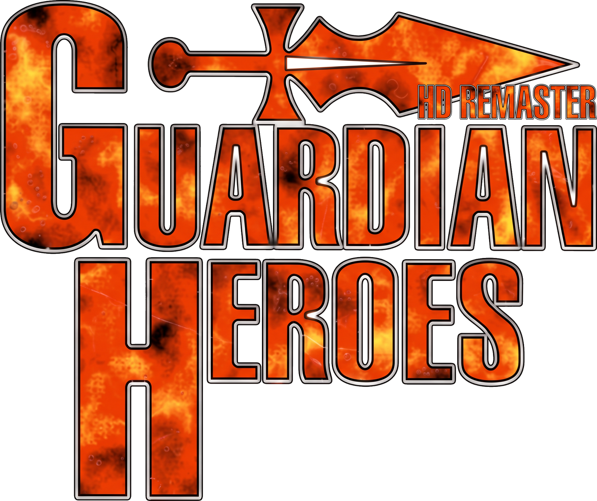
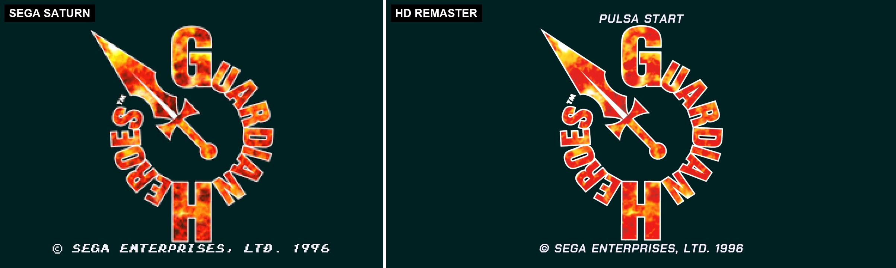
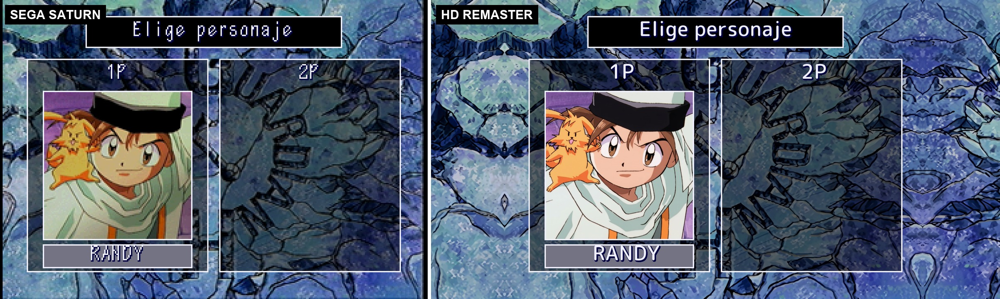
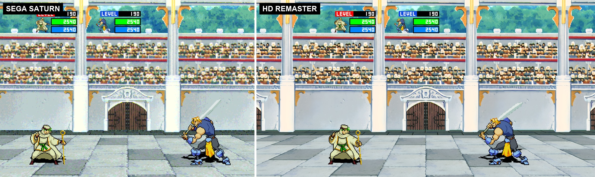
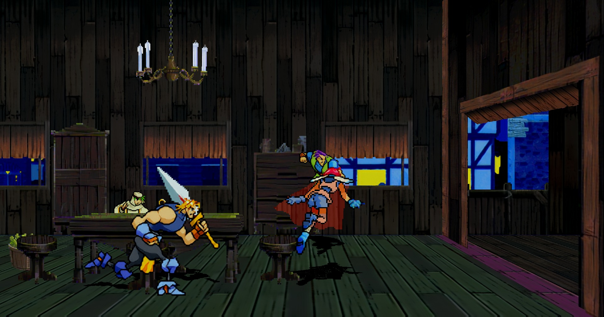
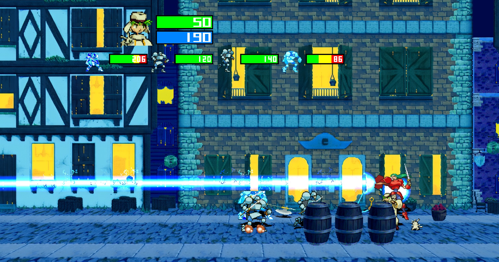
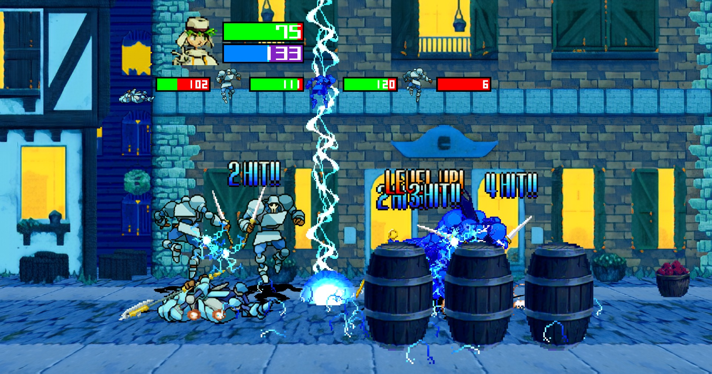

  

  <b>Una versión nativa para PC de Guardian Heroes, reconstruida a partir del juego original de Sega Saturn y remasterizada en alta definición.</b>

  
  
  

  <a href="README.md">🇬🇧 Read in English</a>

---

## Sobre el proyecto

**Guardian Heroes HD Remaster** trae a los PC actuales el beat 'em up con toques de rol de Treasure (1996). Es proyecto
hermano de [Parasite Eve HD Remaster](https://github.com/faligame/Parasite-Eve-HD-Remaster) y de
[Parasite Eve II HD Remaster](https://github.com/faligame/Parasite-Eve-2-HD-Remaster).

**No es un emulador.** El código original de la Sega Saturn (el programa SH-2, con todos los módulos y
overlays del juego) se ha recompilado de forma estática en un ejecutable nativo de Windows, y el hardware de la Saturn
con el que habla el juego (los chips de vídeo VDP1 y VDP2, el sonido y el CD) se ha reescrito de forma nativa para PC.
Eso permite mejorar el juego desde dentro: gráficos HD, panorámico, letras nuevas e idiomas.

Este repositorio es la **casa pública del proyecto**: noticias, capturas, avances y las **descargas** (en
[Releases](https://github.com/faligame/Guardian-Heroes-HD-Remaster/releases/latest)). No contiene código fuente ni datos del juego: necesitas tu propio disco.

> ⭐ Dale una **estrella** y pulsa 👁️ **Watch** para seguir el desarrollo.

---

## Descarga

**[⬇️ Descarga la última versión](https://github.com/faligame/Guardian-Heroes-HD-Remaster/releases/latest)** — v0.1.0, la primera versión pública.

| Sistema | Paquete | Notas |
|---|---|---|
| Windows 10/11 de 64 bits | `win64.zip` | Descomprímelo y abre **GHLauncher.exe** |
| Linux x86_64 | `linux-x86_64.tar.gz` o `.AppImage` | |
| Steam Deck | `.AppImage` | Añádelo a Steam como *juego que no es de Steam*. Aún sin probar en una Deck real |
| macOS | `macos-universal.zip` | **Experimental y sin probar**, todavía sin launcher |

**Necesitas** tu propia imagen del disco *Guardian Heroes* (USA) en **.cue + .bin** y una tarjeta gráfica con
**Vulkan**. El launcher comprueba tu disco, copia sus datos y te ofrece el **pack HD gratuito** (~500 MB, cifrado y
ligado a tu disco). Las actualizaciones del juego y del pack llegan desde el launcher o desde el menú del juego.

En la v0.1 los personajes, enemigos y efectos se ven todavía como en la Saturn: su versión HD llegará en una
actualización del pack HD. Windows puede avisar con *«Windows protegió su PC»* (no hay certificado de firma de pago):
*Más información* → *Ejecutar de todas formas*. Las notas completas y los problemas conocidos están en la
[página de la versión](https://github.com/faligame/Guardian-Heroes-HD-Remaster/releases/latest).

---

## Características

### 🖥️ Versión nativa para PC
- **Recompilación estática** de la versión norteamericana (MK-81035, V1.002) con nuestro propio recompilador SH-2 → C.
  Todo el juego se ejecuta de forma nativa: **cero instrucciones interpretadas**.
- **Sin emulación**: el vídeo, el sonido y el CD de la Saturn están reconstruidos como código nativo de PC, no emulados
  ciclo a ciclo.
- **Renderizado con Vulkan** a alta resolución interna, en ventana o a pantalla completa.
- **Tu disco, importado una sola vez.** El launcher te pide la imagen de tu propio disco (.cue + .bin), comprueba por
  su huella que es el juego correcto y copia sus datos. Después el juego arranca directamente, sin el disco.

### 🎨 Remasterización HD
- **Panorámico 16:9.** En los combates se ve más escenario a los lados (426×224 en lugar de 320×224); los menús y la
  pantalla de título también ocupan todo el ancho.
- **Texturas HD por categorías**: personajes y efectos, fondos de las fases, retratos y letras se sustituyen por
  separado, y cada una se puede cambiar entre **ORIGINAL | HD**.
- **Fondos de fase completos**, reconstruidos desde el disco capa a capa, remasterizados de una pieza y recoloreados en
  vivo con las paletas del propio juego.
- **Letras vectoriales.** Los diálogos y los menús se dibujan con tipografías reales a resolución completa, con
  espaciado proporcional y bordes suaves.
- **Logo HD** encajado en la pantalla de título original.
- **Un botón para comparar**: pulsa **F9** (o **Back** en el mando) para ver el juego como era en la **SEGA SATURN** y
  vuelve a pulsarlo para volver al **HD Remaster**.

### 🌍 Idiomas
- **Inglés, español, francés, alemán e italiano.** Los textos europeos salen de la versión oficial de Xbox Live
  Arcade, leídos de la copia del propio jugador; los títulos de las fases usan los nombres oficiales traducidos.
  Con acentos, ñ, ¡ y ¿.

### ⚙️ Opciones de PC dentro del juego
- **PC Options** está dentro del propio menú de opciones del juego: resolución, panorámico, pantalla completa, vsync,
  idioma, los interruptores HD y las actualizaciones del juego y del pack HD. Un pequeño launcher instala el juego,
  importa tu disco y descarga el pack HD.

---

## Capturas

### Sega Saturn frente a HD Remaster

*Pulsa **F9** en el juego para cambiar de una a otra.*

**Pantalla de título con el logo HD**

**Ajustes PC dentro del menú del juego**

**Elige personaje con los retratos HD**

**Diálogo con letra vectorial y la cara HD (español)**

**El Coliseo en panorámico 16:9 con fondos HD**

### HD Remaster en 16:9

  
  
  
  
  

---

## Hoja de ruta

| Estado | Función |
|:---:|---|
| ✅ | Ejecutable nativo de Windows (recompilación estática, sin código interpretado) |
| ✅ | VDP1 / VDP2 / sonido / CD nativos, renderizado con Vulkan |
| ✅ | Panorámico 16:9 en combates, menús y título |
| ✅ | PC Options dentro del menú del juego |
| ✅ | Español, francés, alemán e italiano con los textos oficiales de XBLA |
| ✅ | Letras HD vectoriales con texto proporcional |
| ✅ | Fondos de fase en HD |
| ✅ | Disco importado una sola vez y comprobado por su huella |
| ✅ | Cambio SEGA SATURN ↔ HD Remaster (F9) |
| 🚧 | Personajes, enemigos y efectos en HD |
| 🚧 | Retratos de diálogo en HD, redibujados a partir del arte oficial |
| 🚧 | Interfaz (HUD) y menús en HD |
| ✅ | Animación de la intro remasterizada |
| ✅ | Launcher que instala el juego a partir de tu propio disco, sin distribuir nunca datos del juego |
| ✅ | Actualizaciones firmadas del juego y del pack HD |
| ✅ | Versiones para Linux y Steam Deck (macOS experimental) |
| ✅ | Versión pública (v0.1.0) |

---

## Noticias

**16-11-2026 — v0.1.0, la primera versión pública**
- **Descárgala** para Windows, Linux / Steam Deck y macOS (experimental) desde [Releases](https://github.com/faligame/Guardian-Heroes-HD-Remaster/releases/latest).
- **Launcher** que comprueba tu disco y descarga el **pack HD gratuito**: fondos, retratos, caras de los diálogos,
  letras, logo y la **intro en HD**.
- **Resoluciones estándar** hasta 3840×2160, en 16:9 o 16:10 (Steam Deck).
- Los personajes, enemigos y efectos en HD llegarán en una actualización del pack HD.

**15-11-2026 — Presentamos el proyecto**
- **Todo el juego funciona de forma nativa** en Windows, sin emulador y sin código interpretado.
- **Panorámico, cinco idiomas, letras vectoriales y fondos HD** ya están dentro.
- **Disco importado una sola vez**: después del primer arranque el juego ya no necesita el disco.
- **F9 cambia** en cualquier momento entre la imagen de la SEGA SATURN y el HD Remaster.

---

## Preguntas frecuentes

**¿Se puede descargar?**
Sí: ya ha salido la v0.1.0. Descárgala desde [Releases](https://github.com/faligame/Guardian-Heroes-HD-Remaster/releases/latest).

**¿Necesitaré el juego original?**
Sí. Necesitarás tu propia copia legal de *Guardian Heroes* para Sega Saturn (versión norteamericana). Los datos del
juego nunca se distribuirán.

**¿Es un emulador?**
No. El código del juego se ejecuta de forma nativa en tu PC tras recompilarse a partir del programa original de la
Saturn.

**¿Hace falta la BIOS de la Saturn?**
No.

**¿Está disponible el código fuente?**
De momento, no.

---

## Créditos

| Proyecto | Autor | Uso | Licencia |
|---|---|---|---|
| [SDL3](https://libsdl.org) | Sam Lantinga y colaboradores | Ventana, controles y audio | zlib |
| [Vulkan-Headers](https://github.com/KhronosGroup/Vulkan-Headers) | Khronos Group | Renderizado con Vulkan | Apache-2.0 / MIT |
| [SteamGridDB](https://www.steamgriddb.com) | Comunidad | Origen del logo HD de la pantalla de título | — |
| [OpenModelDB](https://openmodeldb.info) | Autores de los modelos | Modelos de IA de reescalado usados para remasterizar los gráficos | Según el modelo |

HD Remaster y proyecto: **faligame**.

---

## Aviso legal

Este es un proyecto fan sin ánimo de lucro y no está afiliado, respaldado ni patrocinado por SEGA ni por Treasure.
*Guardian Heroes* es una marca de SEGA. Todo el contenido del juego pertenece a sus respectivos propietarios.
Este repositorio no contiene ni contendrá nunca ficheros del juego, BIOS ni recursos del juego protegidos por derechos
de autor.
