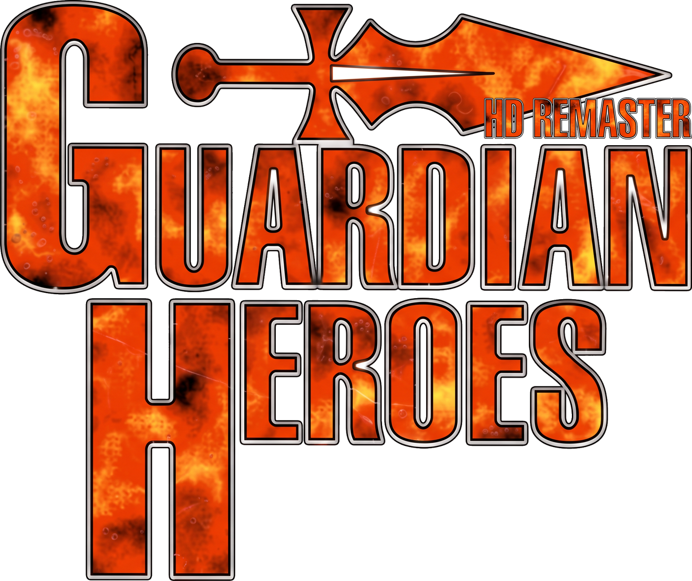

  

  <b>A native PC version of Guardian Heroes, rebuilt from the original Sega Saturn game and remastered in high definition.</b>

  
  
  

  <a href="README.es.md">🇪🇸 Leer en español</a>

---

## About the project

**Guardian Heroes HD Remaster** brings Treasure's 1996 beat 'em up RPG to modern PCs. It is a sister project of
[Parasite Eve HD Remaster](https://github.com/faligame/Parasite-Eve-HD-Remaster) and
[Parasite Eve II HD Remaster](https://github.com/faligame/Parasite-Eve-2-HD-Remaster).

This is **not an emulator**. The original Sega Saturn code (the SH-2 program with every module and overlay of the
game) has been statically recompiled into a native Windows executable, and the Saturn hardware the game talks to (the
VDP1 and VDP2 video chips, sound and CD) has been rewritten natively for PC. That makes it possible to improve the game
from the inside: HD art, widescreen, new fonts and languages.

This repository is the **public home of the project**: news, screenshots and progress. It contains no source code,
executables or game data.

> ⭐ **Star** the repo and hit 👁️ **Watch** to follow development.

---

## Features

### 🖥️ Native PC version
- **Static recompilation** of the North American release (MK-81035, V1.002) with our own SH-2 → C recompiler. The
  whole game runs natively: **zero instructions interpreted**.
- **No emulation**: the Saturn's video, sound and CD are rebuilt as native PC code, not emulated cycle by cycle.
- **Vulkan renderer** with a high internal resolution, windowed or fullscreen.
- **Your disc, imported once.** The first time, the game asks for your own disc image (.cue, .bin or .iso), checks
  that it is the right game by its fingerprint and copies its data next to the game. After that it starts directly,
  without the disc.

### 🎨 HD remaster
- **16:9 widescreen.** Fights show more of the stage on both sides (426×224 instead of 320×224); menus and the title
  screen fill the width too.
- **HD textures by category**: characters and effects, stage backgrounds, portraits and fonts are replaced
  independently, and every one of them can be switched between **ORIGINAL | HD**.
- **Whole stage backgrounds** rebuilt from the disc layer by layer and remastered in one piece, recoloured live with
  the game's own palettes.
- **Vector fonts.** Dialogue and menus are drawn with real typefaces at full resolution, with proportional spacing
  and soft edges.
- **HD title logo** fitted to the original title screen.
- **One button to compare**: press **F9** (or **Back** on the pad) to see the game as it was on the **SEGA SATURN**,
  press it again to go back to the **HD Remaster**.

### 🌍 Languages
- **English, Spanish, French, German and Italian.** The European texts come from the official Xbox Live Arcade
  release, read from the player's own copy; the stage titles use the official translated names. Accents, ñ, ¡ and ¿
  included.

### ⚙️ PC options inside the game
- **PC Options** live inside the game's own options menu: resolution, widescreen, fullscreen, vsync, language and the
  HD switches. No external launcher.

---

## Roadmap

| Status | Feature |
|:---:|---|
| ✅ | Native Windows executable (static recompilation, no interpreted code) |
| ✅ | Native VDP1 / VDP2 / sound / CD, Vulkan renderer |
| ✅ | 16:9 widescreen for fights, menus and title |
| ✅ | PC Options inside the game's menu |
| ✅ | Spanish, French, German and Italian from the official XBLA texts |
| ✅ | Vector HD fonts with proportional text |
| ✅ | HD stage backgrounds |
| ✅ | Disc imported once, checked by fingerprint |
| ✅ | SEGA SATURN ↔ HD Remaster switch (F9) |
| 🚧 | HD characters, enemies and effects |
| 🚧 | HD dialogue portraits, redrawn from the official artwork |
| 🚧 | HD interface (HUD) and menus |
| 🔜 | Remastered opening animation |
| 🔜 | Installer that builds the game from your own disc, so no game data is ever distributed |
| 🔜 | Public release |

---

## News

**15-11-2026 — The project is announced**
- **The whole game runs natively** on Windows, without an emulator and without interpreted code.
- **Widescreen, five languages, vector fonts and HD backgrounds** are already in.
- **One-time disc import**: after the first start the game no longer needs the disc.
- **F9 switches** between the SEGA SATURN picture and the HD Remaster at any moment.

---

## FAQ

**Can I download it?**
Not yet. The project is in active development. Follow this repository to hear about the first release.

**Will I need the original game?**
Yes. You will need your own legal copy of *Guardian Heroes* for Sega Saturn (North American release). Game data will
never be distributed.

**Is it an emulator?**
No. The game code runs natively on your PC after being recompiled from the original Saturn program.

**Do I need a Saturn BIOS?**
No.

**Is the source code available?**
Not for now.

---

## Credits

| Project | Author | Used for | License |
|---|---|---|---|
| [SDL3](https://libsdl.org) | Sam Lantinga and contributors | Window, input and audio | zlib |
| [Vulkan-Headers](https://github.com/KhronosGroup/Vulkan-Headers) | Khronos Group | Vulkan renderer | Apache-2.0 / MIT |
| [SteamGridDB](https://www.steamgriddb.com) | Community | Source of the HD title logo | — |
| [OpenModelDB](https://openmodeldb.info) | Community model authors | AI upscaling models used to remaster the art | Per model |

HD Remaster and project: **faligame**.

---

## Legal notice

This is a non-commercial fan project and is not affiliated with, endorsed or sponsored by SEGA or Treasure.
*Guardian Heroes* is a trademark of SEGA. All game content belongs to its respective owners.
This repository does not and will never contain game files, BIOS or copyrighted game assets.
